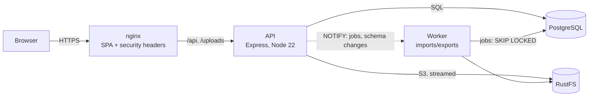

# Zenin-ERP

A no-code ERP. Admins build tables, apps, roles and automations without
writing code. People work with records, limited by **roles** and
**departments**, and every change is kept in an **audit log**.

## Docs

| Guide | For |
|---|---|
| [docs/COMMANDS.md](docs/COMMANDS.md) | every command: install on a server, everyday use, backups, local development, tests |
| [docs/WORKFLOW.md](docs/WORKFLOW.md) | how it works, and how to change it (for developers) |
| [apps/web/UI_GUIDELINES.md](apps/web/UI_GUIDELINES.md) | the UI rules every screen follows |

**Quick start:** `./deploy.sh` on a Linux server, or `task dev` for local
development.

## What's where

| Folder | What |
|---|---|
| `apps/api/` | the API and background worker |
| `apps/web/` | the web app |
| `docs/` | the guides above |
| `.github/workflows/` | CI: `api.yml` and `web.yml`, each runs only when its app changes |
| `deploy.sh`, `docker-compose.yml`, `Taskfile.yml` | install and run it (`./deploy.sh`), development tasks (`task`) |

| Part | Folder | Stack |
|---|---|---|
| Web app | `apps/web/` | React 19, Vite, Mantine 8, TanStack Query |
| API + worker | `apps/api/` | Node 22, TypeScript, Express 5, `pg` |
| Database | Docker `db` | PostgreSQL 16 (+ `pg_trgm`) |
| File storage | Docker `storage` | RustFS (S3-compatible; MinIO, AWS S3 or R2 work too) |

## Architecture



### Request path

1. nginx serves the SPA and forwards `/api` and `/uploads` to the API.
2. The API checks the `X-Requested-With` header on any request that changes
   data (protection against cross-site form posts), then loads the session
   (`erp_session` cookie: httpOnly, SameSite=Lax) together with the user, role
   and departments, in one query.
3. The table's schema comes from an **in-memory cache**. When a schema changes,
   `NOTIFY` tells every API and worker instance to drop its copy.
4. Access rules (`src/auth/access.ts`) decide what the user may do. Record
   queries are always limited to the user's departments.
5. Writes are **validated against the column definitions**, then the change and
   its **audit entry** are committed in a single transaction.

### Data model

```
public (system)                           erp_data (user-defined tables)
──────────────────────────────            ───────────────────────────────────────
table_schemas    columns as JSONB         "<table>"   one Postgres table per ERP table
table_departments                           _id, data JSONB, department_id,
departments, roles (permissions JSONB)      shared_department_ids, created_by,
                                            created_at, updated_at
users, user_departments, sessions         indexes per table:
audit_log        who changed what           department_id, shared_department_ids (GIN),
                                            created_by, (created_at, _id),
jobs             import/export queue        GIN trigram search over all values,
login_attempts   shared login throttling    one sort index per column marked "Indexed"
schema_migrations
```

Records are stored as JSONB, so admins can change columns without migrations.
"User" columns store user ids in `data`, and `created_by` holds the creating
user's id (no foreign key: a deleted account shows as "Deleted user").
The API makes up for what that gives up: it validates every value against its
column (type, required fields, linked records that exist and that the user may
see, real uploaded files), and per-column indexes make sorting fast.

### Access rules

- **Admin role:** everything, including Settings and the full audit log.
- **Other users** can use a table only if their role grants **view** on it *and*
  they share a department with the table. They see and change only records from
  those shared departments. They can read the history of records they can view.
- **Enforced in the API.** Hiding buttons in the UI is only a convenience.

## Project layout

```
docker-compose.yml            db, storage, api, worker, web
apps/api/
  migrations/                 versioned SQL, applied on start-up
  src/server.ts, worker.ts    entry points (API / background worker)
  src/app.ts, routes.ts       Express app, all /api routes
  src/config/env.ts           every setting, read from the environment
  src/db/                     pool + slow-query log, migrations, data tables & indexes
  src/auth/                   access rules, passwords (scrypt), login throttling, first admin
  src/schema/                 column rules, schema cache, record validation
  src/repo/                   SQL for records, users/roles/departments, audit, jobs
  src/controllers/            HTTP handlers
  src/jobs/                   CSV export/import, worker loop
  tests/                      API tests against real Postgres
apps/web/
  src/auth/AuthContext.tsx    current user, login gate
  src/api/                    axios client + React Query hooks
  src/pages/                  tables, record form, jobs, profile, settings (tables/users/roles/departments/audit)
  nginx.conf                  SPA, security headers, /api + /uploads proxy
```
