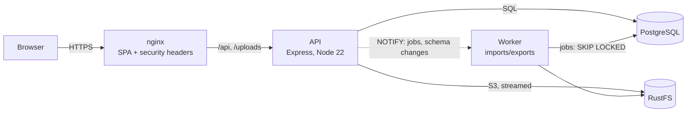

# Zenin-ERP

## What's where

| Folder | What |
|---|---|
| `apps/api/` | The API (Node, TypeScript, Express, Postgres). It was the `GenericApi-mongodb` repository; its history is kept here |
| `apps/web/` | The web app (React, Mantine, Vite). It was the `genericERP-react` repository; its history is kept here |
| `docs/` | Guides: running, deploying, commands, how it works, apps |
| `.github/workflows/` | CI: `api.yml` and `web.yml`, each runs only when its app changes |
| `deploy.sh`, `docker-compose.yml`, `Taskfile.yml` | Install and run it (`./deploy.sh`), development tasks (`task`) |

Each app keeps its own `package.json` and lockfile. A shared pnpm workspace
comes with the developer kit (`packages/sdk`, ROADMAP Phase 3). Settings
(`.env` files), backups and build output are never committed (`.gitignore`).
Business notes and plans live in the separate, private `Zenin-ERP-notes`
repository.


A generic ERP. Admins define tables and columns at runtime, without code changes.
Users work with records in those tables, limited by **role permissions** and
**departments**. Every change is recorded in an **audit log**.

**Docs:** [RUNNING.md](docs/RUNNING.md) covers how to run it (development, Docker,
production, troubleshooting). [WORKFLOW.md](docs/WORKFLOW.md) covers how it works
and how to develop it.
[apps/web/UI_GUIDELINES.md](apps/web/UI_GUIDELINES.md) is the
design system and UI/UX rules that every UI change must follow.
[DEPLOYMENT.md](docs/DEPLOYMENT.md) covers hosting it 24x7 on an office computer for
everyone on the network, with one command (`./deploy.sh`), including backups,
and making it reachable from anywhere over HTTPS (`./deploy.sh public`).
[COMMANDS.md](docs/COMMANDS.md) is the cheat sheet for starting, stopping and wiping
data. For local development, run `task dev` (see `Taskfile.yml`).
[APPS_PLAN.md](docs/APPS_PLAN.md) is the implementation plan for installable apps
(Projects, HR, CRM…) and organization templates (Clinic, School…).

| Part | Folder | Stack |
|---|---|---|
| Web app | `apps/web/` | React 19, Vite, Mantine 8, TanStack Query |
| API + worker | `apps/api/` | Node 22, TypeScript, Express 5, `pg` (the folder name is historical; MongoDB is gone) |
| Database | Docker `db` | PostgreSQL 16 (+ `pg_trgm`) |
| File storage | Docker `storage` | RustFS (S3-compatible; MinIO, AWS S3 or R2 work too) |

---

## Running it

### Everything in Docker (http://localhost:8080)

```bash
cp .env.example .env               # then edit it, see "Going to production"
docker compose up -d --build       # rebuild after code changes
docker compose logs -f api worker  # logs
docker compose down                # stop (data is kept in volumes)
```

### Development with hot reload

Postgres and storage run in Docker. The API, worker and web app run locally.

```bash
docker compose up -d db storage
cd apps/api && pnpm install && pnpm dev   # API on :5000, runs jobs in-process
cd apps/web   && pnpm install && pnpm dev   # web on :5173
```

`pnpm dev` (via `tsx watch`) restarts the API on every change. Restart it
yourself after editing `.env`.

### Useful commands (API folder)

| Command | What it does |
|---|---|
| `pnpm dev` / `pnpm dev:worker` | API / standalone worker with hot reload |
| `pnpm build` then `pnpm start` / `pnpm worker` | compiled production run |
| `pnpm typecheck` | TypeScript check |
| `pnpm migrate` | apply pending database migrations (also done on start-up) |
| `pnpm test` | test suite; needs `TEST_DATABASE_URL` pointing to a throwaway database whose name ends in `_test` (it gets wiped) |
| `pnpm reset-password <user> <password>` | reset a password and re-enable the account (in Docker: `docker compose exec api node dist/scripts/resetPassword.js <user> <password>`) |

On a fresh database the first admin is created from `ADMIN_USERNAME` /
`ADMIN_PASSWORD`. Without a password, a random one is printed to the API log.

| Port | Service |
|---|---|
| 8080 | Web app (nginx; also forwards `/api` and `/uploads` to the API) |
| 5000 | API (bound to 127.0.0.1) |
| 5433 | Postgres (127.0.0.1 only; 5432 is usually taken by a local install) |
| 9000 / 9001 | RustFS S3 API / web console (127.0.0.1 only) |

---

## Architecture



### Request path

1. nginx serves the SPA and forwards `/api` and `/uploads` to the API.
2. The API checks the `X-Requested-With` header on any request that changes
   data (protection against cross-site form posts), then loads the session
   (`erp_session` cookie: httpOnly, SameSite=Lax) together with the user, role
   and departments, in one query.
3. The table's schema comes from an **in-memory cache**. When a schema changes,
   `NOTIFY` tells every API and worker instance to drop its copy.
4. Access rules (`src/auth/access.ts`) decide what the user may do. Record
   queries are always limited to the user's departments.
5. Writes are **validated against the column definitions**, then the change and
   its **audit entry** are committed in a single transaction.

### Data model

```
public (system)                           erp_data (user-defined tables)
──────────────────────────────            ───────────────────────────────────────
table_schemas    columns as JSONB         "<table>"   one Postgres table per ERP table
table_departments                           _id, data JSONB, department_id,
departments, roles (permissions JSONB)      shared_department_ids, created_by,
                                            created_at, updated_at
users, user_departments, sessions         indexes per table:
audit_log        who changed what           department_id, shared_department_ids (GIN),
                                            created_by, (created_at, _id),
jobs             import/export queue        GIN trigram search over all values,
login_attempts   shared login throttling    one sort index per column marked "Indexed"
schema_migrations
```

Records are stored as JSONB, so admins can change columns without migrations.
"User" columns store user ids in `data`, and `created_by` holds the creating
user's id (no foreign key: a deleted account shows as "Deleted user").
The API makes up for what that gives up: it validates every value against its
column (type, required fields, linked records that exist and that the user may
see, real uploaded files), and per-column indexes make sorting fast.

### Access rules

- **Admin role:** everything, including Settings and the full audit log.
- **Other users** can use a table only if their role grants **view** on it *and*
  they share a department with the table. They see and change only records from
  those shared departments. They can read the history of records they can view.
- **Enforced in the API.** Hiding buttons in the UI is only a convenience.

---

## Scalability: what was done

The earlier review found the bottlenecks were in **how data is stored and
queried**, not in Node. The language and framework were kept; these changes
were made instead:

| # | Change | Where |
|---|---|---|
| 1 | Uploads **stream** to storage (busboy → S3 multipart, about 16 MB of RAM per upload at most). nginx streams request bodies through too. | `controllers/files.ts`, `storage.ts`, `nginx.conf` |
| 2 | Relation dropdowns **search on the server** (`?search=`, `?ids=`, limit 50) | `recordRepo.getRecordOptions`, `RelationField.tsx` |
| 3 | **Schema cache**, invalidated across instances via `LISTEN/NOTIFY` | `schema/schemaRepo.ts` |
| 4 | Server-side **validation** of every record (types, required fields, relations, files), with errors per field | `schema/validateRecord.ts` |
| 5 | **Trigram search index**, per-column **sort indexes** (the "Indexed" toggle), **estimated totals** on big tables | `db/dataTables.ts`, `recordRepo.listRecords` |
| 6 | Backend in **TypeScript** (strict) with **tests** (vitest + supertest on real Postgres) and **CI** for both repos | `src/`, `tests/`, `.github/workflows/ci.yml` |
| 7 | Versioned **SQL migrations** with an advisory lock (safe with several instances) | `migrations/`, `db/migrate.ts` |
| 8 | **Structured logs** (pino, request ids), **Prometheus metrics**, **slow-query log** | `lib/logger.ts`, `lib/metrics.ts`, `db/pool.ts` |
| 9 | **Audit log** for records, logins, users, roles, departments, tables and columns, with a per-record History drawer and an admin Audit log page | `repo/auditRepo.ts`, `AuditLogPage.tsx`, `RecordHistory.tsx` |
| 10 | **Background worker** for CSV import/export (Postgres queue, `FOR UPDATE SKIP LOCKED`) | `jobs/`, docker `worker` service |
| 11 | Fast typed sorting through **indexed expression columns** (see the note below) | `sortExpression`, `syncColumnIndexes` |

Also:
- **Login throttling** moved to Postgres, so it works with several API instances.
- **Security headers:** helmet on the API, a CSP on nginx.
- **Graceful shutdown.**
- **Health checks** that also check the database.
- **Lazy-loaded pages:** the main bundle dropped from 1.2 MB to 218 kB.
- **Docker:** a non-root multi-stage image, and the database, storage and API
  bound to 127.0.0.1.

> **Note on #11.** Instead of copying hot fields into real typed Postgres
> columns, each column marked **Indexed** gets an index on its typed expression
> (`erp_try_numeric(data->>'price')` for numbers, the text value otherwise).
> Sorting then uses that index, which gives the same query speed as a real
> column. It needs no table rewrites and works on existing data. Data
> integrity, the other reason for typed columns, comes from validation (#4).

### Measured

Measured on a laptop: 200,000 records in one table, one API process, results
from the second run.

| Request | Time |
|---|---|
| First page (newest first) | 4 ms |
| Search "contains" (trigram index) | 4 ms |
| Sort by an **indexed** number column | 3–4 ms |
| Sort by a column that isn't indexed | ~50 ms (turn on "Indexed" for columns people sort by) |
| Page 500 (50 per page) | 11 ms |
| Relation dropdown search | 7 ms |

The API process used about 98 MB RSS (25 MB heap), and no slow queries were
logged.

### Known limits and next steps

- **Paging still uses OFFSET.** With indexes, page 500 takes 11 ms. Only very
  deep pages (tens of thousands of rows in) get slow; search is the intended
  way to find a record in large tables.
- **Sort order of empty values:** they sort last ascending and **first**
  descending. This is Postgres' default, kept so the sort indexes can be used.
- **Uploaded files are served through the API,** which checks the login. For
  very high traffic, switch to short-lived presigned URLs.
- **Who sees a table's records is a per-table choice:** everyone who can use
  it (apps, and tables made in the app), or each department only its own
  ("Visible to", one or several departments per record).
- **Rich text exports as plain text** in CSV.

---

## Going to production

1. **Secrets:** copy `.env.example` to `.env` and set strong values for
   `POSTGRES_PASSWORD`, `S3_ACCESS_KEY` and `S3_SECRET_KEY`. Set
   `ADMIN_PASSWORD`, then change it after the first login.
2. **HTTPS:** put a TLS proxy in front of port 8080 (Caddy, Traefik, a cloud
   load balancer). Then set `COOKIE_SECURE=true`.
3. **Exposure:** only the web port (8080) needs to be reachable. The database,
   storage and API are bound to 127.0.0.1.
4. **Backups:**
   - Database:
     ```bash
     docker compose exec -T db pg_dump -U postgres -Fc generic_erp > backup-$(date +%F).dump
     # restore: docker compose exec -T db pg_restore -U postgres -d generic_erp --clean < backup.dump
     ```
   - Files: back up the `storage` volume (or mirror the bucket with an S3 tool).
     Test a restore.
5. **Monitoring:**
   - Set `METRICS_TOKEN` and scrape `http://api:5000/metrics` with
     `Authorization: Bearer <token>`. It includes HTTP latency per route, DB
     query time, slow queries, job counts and Node memory.
   - Logs are JSON on stdout. Slow queries (over `SLOW_QUERY_MS`, default
     500 ms) are logged with their SQL.
6. **Scaling out:**
   - The API is stateless: run more `api` containers behind nginx.
   - Run more `worker` containers for heavier import/export loads.
   - Keep `PG_POOL_MAX × instances` below Postgres' `max_connections`, or add
     PgBouncer.
7. **Upgrades:** migrations run automatically on start-up and are safe with
   several instances. To run them as a separate deploy step, use
   `docker compose run --rm api node dist/scripts/migrate.js`. Back up the
   database before upgrading.

---

## Project layout

```
docker-compose.yml            db, storage, api, worker, web
apps/api/
  migrations/                 versioned SQL (001_init, 002_production)
  src/server.ts, worker.ts    entry points (API / background worker)
  src/app.ts, routes.ts       Express app, all /api routes
  src/config/env.ts           every setting, read from the environment
  src/db/                     pool + slow-query log, migrations, data tables & indexes
  src/auth/                   access rules, passwords (scrypt), login throttling, first admin
  src/schema/                 column rules, schema cache, record validation
  src/repo/                   SQL for records, users/roles/departments, audit, jobs
  src/controllers/            HTTP handlers
  src/jobs/                   CSV export/import, worker loop
  tests/                      API tests against real Postgres
apps/web/
  src/auth/AuthContext.tsx    current user, login gate
  src/api/                    axios client + React Query hooks
  src/pages/                  tables, record form, jobs, profile, settings (tables/users/roles/departments/audit)
  nginx.conf                  SPA, security headers, /api + /uploads proxy
```
